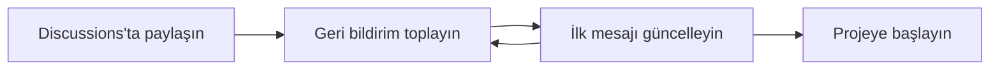

# Bir proje fikri nasıl paylaşılır?

:::tip[Kısaca]

- **Problem → çözüm fikri → ilk kapsam → geri bildirim çağrısı** sırasıyla anlatın.
- Kısa yazmak yeterlidir; önemli olan başkasının fikri anlayıp tartışabilmesidir.

:::

Octacity'de bir proje fikri ortaya çıktığında, henüz repository açmadan veya kod yazmaya başlamadan önce fikrinizi [Octacity Discussions](https://github.com/orgs/octacity-org/discussions) üzerinde **İngilizce** paylaşın. Hangi problemi gördüğünüzü, nasıl bir çözüm düşündüğünüzü ve ne hakkında geri bildirim istediğinizi anlatın.

Fikrin tamamlanmış bir tasarıma dönüşmesini beklemeniz gerekmez. Kısa bir açıklama da, başlıklara ayrılmış daha ayrıntılı bir öneri de uygundur. Önemli olan, başka birinin fikri anlayıp tartışmaya katılabilmesidir. Dokümantasyon Türkçe olabilir; fikrin kendisini ve tartışma çağrısını İngilizce yazın.

## Ne zaman?

- Yaşadığınız bir problemi çözmek için yeni bir araç geliştirmeyi düşündüğünüzde,
- Bir fikrin başkaları için de yararlı olup olmayacağını öğrenmek istediğinizde,
- Yaklaşım, kullanım senaryoları veya ilk kapsam konusunda topluluktan görüş almak istediğinizde.

## Neleri anlatmalıyım?

<div className="steps">

1. **Problem:** Bugün ne zor, eksik veya gereksiz yere zahmetli? Bu durumla kim karşılaşıyor? Mümkünse kendi yaşadığınız bir örnekle anlatın.
2. **Çözüm fikri:** Nasıl bir araç veya yaklaşım düşünüyorsunuz? Birkaç cümlede ne yapacağını açıklayın.
3. **İlk yön ve kapsam:** Şu anda hangi yetenekleri düşünüyorsunuz? Daha sonraya bırakılabilecek fikirleri ve henüz karar vermediğiniz noktaları ayırın.
4. **Geri bildirim çağrısı:** Okuyucudan ne hakkında görüş istiyorsunuz? Kullanım senaryoları, mevcut alternatifler, kapsam veya teknik yaklaşım hakkında somut sorular sorun; katkıya açık olduğunuzu belirtin.

</div>

Mevcut Discussions içinde benzer bir fikir olup olmadığına bakın. Bildiğiniz benzer araçlar varsa, sizin ihtiyacınızı neden karşılamadıklarını açıklayın. Bilmiyorsanız bunu açıkça söyleyip alternatif önerileri isteyin.

:::note[Zorunlu şablon değil]

Bu maddeler zorunlu başlıklar değildir. Birkaç paragraf ve kısa bir liste yeterli olabilir. Kesin proje adı, teknoloji seçimi, ayrıntılı mimari veya bitiş tarihi belirlemeniz gerekmez; düşündüğünüz seçenekleri karar verilmiş gibi sunmayın.

:::

## Üç kabul edilebilir anlatım biçimi

<Tabs>
<TabItem value="repozip" label="Kısa: Repozip" default>

[Repozip önerisi](https://github.com/orgs/octacity-org/discussions/5), kısa bir anlatımın yeterli olabileceğini gösterir. Yerel bir repository'yi web tabanlı LLM'lerle paylaşmak için dosyaları elle seçme sorununu anlatır. Ardından Git repository'sini paketleyen bir CLI fikrini ve `.gitignore` kurallarını gözetme, `.git` dizinini dışarıda bırakma, ZIP veya Markdown üretme gibi düşündüğü yetenekleri sıralar. Gelecekteki Markdown geliştirmelerini ayrı bir olasılık olarak bırakır ve kullanım senaryoları ile özellikler hakkında görüş ister.

</TabItem>
<TabItem value="ash" label="Ayrıntılı: ash">

[ash önerisi](https://github.com/orgs/octacity-org/discussions/15), daha ayrıntılı bir biçim kullanır. Coding agent'ın ihtiyaç duyduğu ortamın başka bir makinede bulunması sorunundan başlayıp SSH üzerinden uzak makine işlemleri önerir. Küçük bir işlem kümesi, güvenlik sınırları ve ileride araştırılabilecek kalıcı shell oturumları üzerinden yönünü açıklar. Sonunda hangi uzak işlemlerin sunulması ve uzak çalıştırma ile orkestrasyon arasındaki sınırın nerede olması gerektiğini tartışmaya açar.

</TabItem>
<TabItem value="omniship" label="Başlıklı: OmniShip">

[OmniShip önerisi](https://github.com/orgs/octacity-org/discussions/17), daha geniş bir fikri başlıklarla anlatır. Dil ve ekosisteme bağlı release araçlarının sınırlarını açıklayıp Check, Build ve Ship modelini önerir. İşlem grafikleri, artifact akışı, plugin sınırları ve yapılandırma gibi konuları ayrı bölümlerde ele alır; bu alanlar hakkında geri bildirim ister.

</TabItem>
</Tabs>

:::info[Üçünün ortak noktası]

**Uzunluk veya aynı şablonu kullanmaları değildir:** Somut bir problemden başlayıp çözümün amacını ve düşündükleri yönü anlaşılır kılarlar. Henüz araştırılacak noktaları açık bırakır, görüş ve katkı çağrısıyla tartışmaya alan açarlar. Fikriniz Repozip kadar kısaysa sırf daha ciddi görünmek için ash veya OmniShip kadar uzun yazmanız gerekmez.

:::

## Kısa bir İngilizce örnek

Aşağıdaki metin, Repozip fikrinden hareketle kısaltılmış bir örnektir; özgün Discussion'ın birebir kopyası değildir:

```markdown
# Repozip — A repository packaging tool

Sharing a local repository with a web-based LLM often means selecting and uploading files manually.

I'm considering a small CLI that packages a Git repository, respects .gitignore, excludes .git, and exports ZIP or Markdown. It could include either the committed files or the current working tree.

Richer Markdown output could come later. The name and initial scope are still open.

Would this help your workflow? Are there existing tools I should look at, and which features would matter first?

Feedback and contributions are welcome.
```

## Paylaştıktan sonra



Gelen soruları yanıtlayın ve fikriniz değiştikçe ilk mesajı güncelleyin. Aynı problemi yaşayanların örnekleri, mevcut araç önerileri veya kapsam itirazları, fikri daraltmanıza ya da başka bir yöne çevirmenize yardımcı olabilir.

:::note

Discussion, fikri birlikte değerlendirmek için bir başlangıçtır; tamamlanmış proje planı veya teslim sözü değildir.

:::

 İlk somut adımı seçmeye hazır olduğunuzda [Bir projeye nasıl başlanır?](./projeye-nasil-baslanir.md) ve [Fikri nasıl küçültürüm?](./fikri-nasil-kuculturum.md) rehberlerine geçin.

## Sık yapılan hatalar

<div className="comparison-grid">
  <div className="comparison-box comparison-bad">
    <div className="comparison-title">❌ Yalnızca isim</div>
    <p><em>"Bir repository paketleme CLI'ı yapacağım, ne dersiniz?"</em></p>
    <small>⚠️ Okuyucu hangi problemi çözdüğünüzü ve neye yorum yapacağını bilemez.</small>
  </div>
  <div className="comparison-box comparison-good">
    <div className="comparison-title">✅ Problem + soru</div>
    <p><em>"Web LLM'lerine repository yüklemek için dosyaları elle seçiyorum. .gitignore'a uyan bir paketleyici işinize yarar mı?"</em></p>
    <small>✓ Problem, fikir ve geri bildirim çağrısı tek bakışta görünür.</small>
  </div>
</div>

- **Yalnızca isim paylaşmak:** “Bir CLI yapacağım” demek yerine hangi problemi çözeceğini anlatın.
- **Fikri kusursuzlaştırana kadar saklamak:** Erken sorular ve itirazlar, kod yazmadan önce yönünüzü netleştirebilir.
- **Teknik ayrıntıyla problemi gölgelemek:** Teknoloji listesinden önce ihtiyacı ve beklenen faydayı açıklayın.
- **Belirsiz bir görüş çağrısı yapmak:** Genel yorumların yanında hangi konuda kararsız olduğunuzu da belirtin.

## Daha fazla bilgi

- Fikrinizi paylaşmak için [Octacity Discussions](https://github.com/orgs/octacity-org/discussions).
- Mevcut bir projedeki somut işi tanımlamak için [İyi bir Issue nasıl yazılır?](../github/iyi-issue-nasil-yazilir.md).
